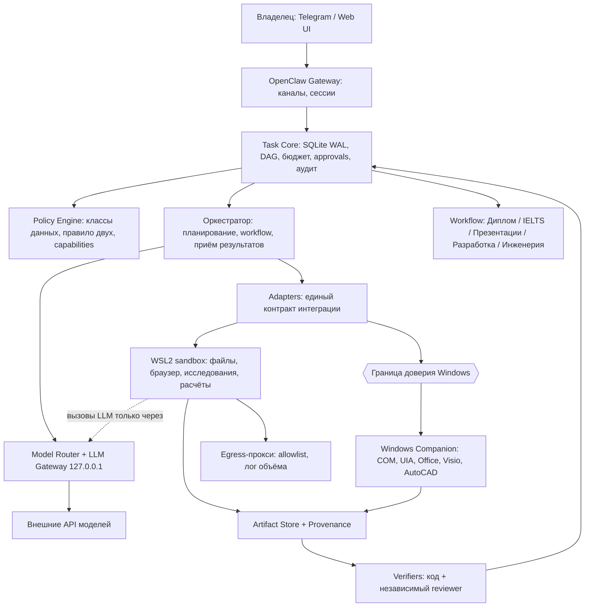

# 16. Архитектура универсального OpenClaw: субагенты, навыки, MCP и программные движки

**Версия:** 0.2 — исправленный проект архитектурного дополнения, 11.11.2026
**Заменяет:** v0.1 от 11.11.2026
**Назначение:** передать агенту-разработчику проверяемый перечень готовых проектов и конкретную схему их безопасной интеграции.
**Базовый документ:** `15-ТЗ-для-агента-разработчика.md`, v1.3 от 10.11.2026. Поправки к нему вынесены в `15-ТЗ-поправки-v1.4.md`.
**Область:** универсальный локальный ИИ-помощник, **не** система исключительно для написания диплома.
**Статус:** архитектурное предложение. Ни один из перечисленных проектов не установлен и не прошёл сквозные тесты.

> **Условные обозначения.** `[БАЗА]` — есть в ТЗ 15; `[УНИВЕРСАЛЬНЫЙ +]` — расширение общей платформы; `[ДИПЛОМ +]` — только сценарий российского диплома специалитета; `[ИСПРАВЛЕНО v0.2]` — место, изменённое относительно v0.1.
>
> **Честность источников.** Все GitHub-ссылки и описания возможностей перенесены из v0.1 **без повторной проверки** в этой редакции. Каждый проект считается `claimed` (заявлен в README) до выполнения S0B-T5 (проверка существования, коммита, лицензии, активности). «Есть на GitHub» ≠ «установлено, работает, безопасно, качественно».

---

## Журнал изменений v0.1 → v0.2

| ID | Что было не так в v0.1 | Что исправлено |
|---|---|---|
| F-01 | v0.1 запрещала выделять `reader` как LLM-профиль, но ТЗ 15 §6A.1.2 требует Q-LLM `reader` (dual-LLM). Дыра в защите от prompt injection | `reader` возвращён как обязательный LLM-профиль AG-00 без инструментов; код-парсеры (`document-ingest`) отделены от него (§2.1) |
| F-02 | `calc`, `doc`, `verifier`, `learner` из ТЗ 15 §6A.2.1 в v0.1 не сопоставлены | Таблица соответствия профилей ТЗ 15 ↔ AG-xx ↔ `tool_capability`/`system_service` (§2.3) |
| F-03 | Идентификаторы A01–A11 совпадали с уровнями автономии A0–A4 из ТЗ 15 §6B.4-A | Профили переименованы в AG-00…AG-11 |
| F-04 | Не учтено «правило двух» (ТЗ 15 §6B.4-B). GUI-агент (экран + приложения + действия) по умолчанию даёт запрещённую комбинацию | Таблица `trifecta` по каждому профилю, режимы `closed-world`/`open` (§2.2) |
| F-05 | Сторонние проекты (AutoResearchClaw, Agent-S, PPT Master, browser-use) имеют собственные LLM-циклы и ключи: обход Model Router, бюджета, классов данных | Обязательный **LLM Gateway** на loopback с эфемерным ключом на job (§3.2) |
| F-06 | Нет единого контракта интеграции стороннего проекта | **Adapter contract** и тест-набор соответствия (§3.1) |
| F-07 | Скриншоты и HAR могут содержать `LOCAL_ONLY`-данные, но правил передачи в VLM не было | Правила визуального канала и обработки HAR (§3.4, §5) |
| F-08 | Windows Companion с COM-доступом к настоящему Office — наибольшая привилегия системы, граница доверия не описана. Не проверена связность WSL↔Windows | Граница доверия Windows и варианты изоляции (§3.3), U-16 |
| F-09 | Чужие `SKILL.md` и описания MCP-инструментов — это недоверенный исполняемый текст (prompt injection, подмена описаний) | Цепочка поставок навыков: вендоринг, хеши, ревью, закрепление описаний (§3.5) |
| F-10 | Статусы `documented/tested_in_sim/tested_live/tested_target` конфликтовали с реестром ТЗ 15 §10.4 | Единое сопоставление статусов (§10) |
| F-11 | MVP начинался с GUI и PowerPoint-анимации до готовности Task Core; наличие Office не подтверждено (U-07) | Дорожная карта по зависимостям, лестница деградации для анимаций (§8) |
| F-12 | Не определено, кто владеет состоянием: «OpenClaw + Task Core» двусмысленно | Матрица ответственности (§1.1) |
| F-13 | Выбор между кандидатами (ADR-A…H) без критериев | Жёсткие ворота и протокол bake-off с `pass^k` (§7) |
| F-14 | Лицензии: GPL/AGPL-компоненты упомянуты, правила использования нет | Политика лицензий и процессной изоляции (§7.3) |
| F-15 | Диплом: нет ворот академической добросовестности и инженерной ответственности | Ворота AI-политики вуза и «не заключение о безопасности» (§4.9) |
| F-16 | Этапы S10, S17, S21, S16 не получили задач из архитектуры | Обновлена таблица интеграции в этапы (§8.1) |

---

## 0. Решения, которые необходимо зафиксировать до реализации

1. **Один Task Core, один оркестратор.** Состояние, очередь, политика, бюджет, approvals, аудит — только в Task Core (ТЗ 15 S1–S2). OpenClaw Gateway — канальный и сессионный рантайм. Специализации не создают собственных очередей, памяти, политик и бюджетов.
2. **Не всё — LLM-субагент.** Парсеры, расчёты, форматтеры, I/O — код, SDK, CLI или MCP. LLM-профилем становится только смысловая работа. Обязательные LLM-профили с особой ролью: `reader` (Q-LLM без инструментов), `verifier`, `learner` (ТЗ 15 §6A.2.1).
3. **Совместимость с ТЗ 15.** Названия `subagent profile` из реестра S18 разделяются ADR на `agent_profile` / `tool_capability` / `system_service` (§2.3). Контракты и тесты не удаляются молча.
4. **Workflow-first** (ТЗ 15 §6B.4-F). Task Core владеет DAG, статусами, зависимостями, ретраями, блокировками, approvals, дедлайнами, стоимостью, верификацией. LLM выбирает способ решения только внутри разрешённых границ.
5. **Приоритет способа исполнения:** нативный API/CLI/формат файла → COM / Office.js / UIA → DOM/CDP → визуальный GUI → координатные клики. Повторяемые веб-действия превращаются в тестируемые API-клиенты только там, где это разрешено.
6. **Один пишущий исполнитель на ресурс** (файл, документ, профиль браузера, GUI-сеанс, vault). Параллельные исследователи по умолчанию read-only.
7. **Сторонний проект с внутренними LLM-циклами — только в виде одного ограниченного job** за адаптером и LLM Gateway (§3). Его внутренние шаги не доверенные шаги Task Core, а его результат — полуфабрикат, принимаемый только после независимой проверки. `[ИСПРАВЛЕНО v0.2]` Проект, который нельзя направить через Gateway и запустить в sandbox, не допускается к работе с данными классов `private`/`LOCAL_ONLY`.
8. **Dev-local без деплоя.** Для Windows COM, Office, Visio, AutoCAD — capability probes, fake-companion, контрактные тесты до разрешённого живого прогона. Подготовка к боевому режиму не включает его.
9. **Одна машина, без VPS.** Ориентир: HP Pavilion, Windows 11 + WSL2, около 16 ГБ RAM, 512 ГБ SSD (уточняется инвентаризацией S0). Большие LLM — удалённые API; локально — небольшие службы по требованию.
10. **Сначала проверка исходного артефакта, потом успех.** Изменённый `.pptx`/`.dwg` не считается готовым, пока не доказаны открываемость, редактируемость и соответствие критериям задания.
11. **Правило двух для каждой сессии и профиля** (ТЗ 15 §6B.4-B). Комбинация «недоверенный ввод + чувствительные данные + внешнее/необратимое действие» отклоняется Policy.
12. **Данные классов `LOCAL_ONLY`/`secret` не покидают ноутбук**, включая скриншоты, HAR, VLM-вызовы, временные файлы и внутренние вызовы сторонних проектов.
13. **Уровень автономии по умолчанию A1**, потолок для каждого профиля — §2.2. Уровень A4 не включается.
14. **Лицензии:** по умолчанию допускаются MIT/Apache-2.0/BSD (ТЗ 15 В-14). GPL/AGPL/неизвестные — только как отдельный процесс без копирования кода, по решению владельца (§7.3).

### Соответствие исходным разделам ТЗ 15

- S1–S3: Task Core, Policy, Artifact Store — использовать как есть, расширять сущности без второго хранилища.
- S4–S6: Model Router, Jev, ingress, оркестратор — общий слой; **LLM Gateway — часть Router (S4)**, а не отдельная система.
- S7: файлы/документы/код/sandbox; S8: браузер; S9: Obsidian; S10: портал; S11: PDF/изображения.
- S12–S13: Windows Companion, Office/CAD, конвейер изучения программ O0–O7.
- S14: прикладные сценарии «диплом», «IELTS», «презентации» — не отдельные продукты.
- S15: benchmarks; S16: hardening; S17–S21: безопасность, субагенты, расчёты, Telegram, память/обучение.

---

## 1. Слои системы и границы ответственности

### 1.1. Матрица ответственности `[ИСПРАВЛЕНО v0.2]`

| Функция | Владелец | Не делает |
|---|---|---|
| Состояние задач, DAG, статусы, jobs, lease | **Task Core** | OpenClaw, субагенты |
| Решения allow/deny/approval, классы данных, правило двух | **Policy Engine** | Модели, Jev, сторонние проекты |
| Выбор модели, бюджет, лог `model_calls`, фильтр класса данных | **Model Router + LLM Gateway** | Сторонние проекты напрямую |
| Каналы Telegram/Web, сессии, node mode, Control UI | **OpenClaw Gateway** | Хранение истины о задаче |
| Планирование, диспетчеризация, приём результата | **Оркестратор** (`src/orchestrator`) | Выполнение инструментов |
| Выполнение инструмента | **Adapter** в sandbox/на Windows Companion | Выдача себе прав |
| Проверка результата | **Verifiers** (код) + `verifier` (LLM) | Исполнитель |
| Хранение артефактов и provenance | **Artifact Store** | Воркеры напрямую |

### 1.2. Общий граф



**Иерархия вызовов** задаёт Task Core: `max_depth=1`, `may_spawn=false` по умолчанию (ТЗ 15 §6A.2.3). Workflow — хранимый граф задач, а не «субагент в субагенте».

### 1.3. Контракт исполнения `[ИСПРАВЛЕНО v0.2]`

Приведён в соответствие с манифестом ТЗ 15 §6A.2.2 и карточкой §6C.3.2. Псевдосхема, **не** готовый конфиг OpenClaw:

```json
{
  "task_id": "uuid", "step_id": "uuid", "agent_profile": "AG-08-presentation-designer",
  "objective": "Создать 8 слайдов из проверенного отчёта с Morph",
  "input_artifacts": [
    {"ref": "artifact:report-pdf", "trust": "trusted", "data_class": "private"},
    {"ref": "artifact:charts-json", "trust": "trusted", "data_class": "private"}
  ],
  "decision_log": ["Тема оформления: светлая", "Единицы: СИ"],
  "capabilities": [
    {"tool": "ppt-master", "args_policy": "paths_in:workdir"},
    {"tool": "office-mcp.powerpoint", "args_policy": "paths_in:workdir", "host": "windows-companion"}
  ],
  "data_class": "private", "autonomy_level": "A1",
  "trifecta": {"A_untrusted_input": false, "B_sensitive_access": true, "C_state_change_or_external": true},
  "limits": {"max_depth": 1, "may_spawn": false, "memory_write": "none"},
  "read_set": ["workdir/in/**"], "write_set": ["workdir/out/deck-v1.pptx"],
  "exclusive_resources": ["presentation:deck-v1.pptx", "windows:office_session"],
  "budget": {"usd": 1.0, "tokens": 400000, "tool_calls": 50, "wall_s": 1200},
  "model_profile": "presentation-designer-default", "effort": "high",
  "policy_version": "…", "gateway_job_key": "ephemeral",
  "acceptance": ["pptx_opens", "all_text_editable", "animations_persist_native", "review_all_slides"],
  "output_schema": "schemas/presentation_result.v1.json"
}
```

Выход содержит `status`, `artifact_refs`, `source_refs`, `evidence`, `verification_results`, `warnings`, `model_calls`, `tool_trace`, `cost`. Статус `success` без независимых доказательств не принимается (ТЗ 15 §6A.2.3 п.5).

---
## 2. Субагенты, профили и правило двух

### 2.1. Логический реестр LLM-профилей `[ИСПРАВЛЕНО v0.2]`

Это **логический** реестр, а не 12 постоянно запущенных процессов. Профили могут работать на одном runtime с разными model profiles. Состав подлежит A/B-проверке (S15).

| ID | Профиль | Когда нужен LLM | Инструменты / база | Граница |
|---|---|---|---|---|
| AG-00 | `quarantine-reader` (Q-LLM) **[БАЗА]** | Извлечение полей из недоверенного контента в типизированную схему | **Нет инструментов, нет сети, нет записи** | Результат всегда `untrusted`; не планирует |
| AG-01 | `browser-agent` | Многошаговые действия на заранее неизвестных страницах | OpenClaw Browser, agent-browser, browser-use, Playwright/CDP | Не подменяет обычные HTTP-вызовы |
| AG-02 | `desktop-agent` | Нестандартные GUI, модальные окна | OpenClaw Computer Use, Agent-S, CUA, UIA | Не использовать GUI, если есть API; режим — §2.2 |
| AG-03 | `coding-agent` **[БАЗА]** | Разработка, отладка, тесты | Git, shell в sandbox | Worktree, без секретов, без сети по умолчанию |
| AG-04 | `research-agent` | Декомпозиция вопроса, сбор противоречащих данных | GPT Researcher, AutoResearchClaw, PaperQA2, Zotero | Два режима — §2.2; источники недоверенные |
| AG-05 | `engineering-agent` | Выбор методики, параметров модели; **автор кода расчёта** (`calc`) | Calculation Engine, Modelica, pandapower, SciPy | Арифметику не считает; код пишет, числа даёт исполнение |
| AG-06 | `cad-agent` | Проектные решения, изменения схем и чертежей | AutoCAD MCP, Visio MCP, ezdxf, draw.io MCP | Геометрию и нормоконтроль проверяет код |
| AG-07 | `writing-agent` | Содержательное составление и переработка текстов | OpenDraft, PaperOrchestra; OfficeCLI/Office MCP как инструменты | Не отдельный LLM ради форматирования |
| AG-08 | `presentation-designer` | Сюжет, композиция, дизайн, сценарий анимации | PPT Master, SlidePoise, Presenton, PPTAgent, Office MCP | Статичный PPTX не доказывает анимацию |
| AG-09 | `verifier` / `review-agent` **[БАЗА]** | Независимая смысловая оценка | PaperOrchestra review, рубрики | Другой профиль/модель, чем исполнитель; без рассуждений исполнителя; детерминированные проверки приоритетнее |
| AG-10 | `program-explorer` **[БАЗА]** | Изучение незнакомого ПО (O0–O7) | probe, документация, Agent-S | Только копии; без автоустановки MCP и повышения прав |
| AG-11 | `tutor-agent` | Диалог, диагностика знаний, объяснение ошибок | STT/TTS, рубрики IELTS | STT, произношение, интервалы повторения — код |
| AG-12 | `learner` **[БАЗА]** | Разбор трасс сбоев, предложения уроков | Read-only журналы | Только предложения (ТЗ 15 §6A.6) |

### 2.2. Правило двух по профилям `[УНИВЕРСАЛЬНЫЙ +]`

Обозначения как в ТЗ 15 §6B.4-B: **A** — обрабатывает недоверенный ввод; **B** — доступ к чувствительным данным/системам; **C** — меняет состояние вне scratch-каталога или общается наружу. Классификаторы и Jev не снимают ни одно из свойств.

| Профиль / режим | A | B | C | Допустимо? | Потолок автономии | Условие |
|---|---|---|---|---|---|---|
| AG-00 reader | да | нет | нет | да | A1 | Нет инструментов |
| AG-01 browser | да | нет | да | да (A+C) | A1 | Изолированный профиль, без vault и секретов; отправка формы — approval |
| AG-02 desktop, **closed-world** | нет | да | да | да (B+C) | A1 | Только разрешённые приложения и **копии** файлов; браузер, почта, мессенджеры на экране исключены; снимки не уходят во внешний VLM при `LOCAL_ONLY` |
| AG-02 desktop, **open** | да | да | да | **нет** | — | Допускается только пошаговый approval человеком или разбиение на сессии |
| AG-03 coding | нет | нет | да | да | A2 | Worktree, без секретов, без сети |
| AG-04 research, **web-mode** | да | нет | нет | да (A) | A1 | Только read-only fetch через egress-прокси, без приватного корпуса |
| AG-04 research, **corpus-mode** | нет | да | нет | да (B) | A1 | Сеть выключена; внешние тексты поступают только как типизированные значения через AG-00 |
| AG-05 engineering | нет | да | да | да | A2 | Результаты — на копиях, расчёты в sandbox |
| AG-06 cad | нет | да | да | да | A2 | Только копии; оригинал read-only |
| AG-07 writing | нет | да | да | да | A2 | Внешние источники — через evidence store и AG-00 |
| AG-08 presentation | нет | да | да | да | A2 | Рендер и Office — на Windows Companion в границе доверия |
| AG-09 verifier | нет | да | нет | да | A1 | Read-only |
| AG-10 program-explorer | да | нет | да | да (A+C) | A1 | Документация вендора + песочница на копиях; без B |
| AG-11 tutor | нет | да | нет | да | A1 | История обучения — `private`, не уходит провайдеру без решения |
| AG-12 learner | нет | да | нет | да | A0 | Только предложения |

Policy отклоняет манифест, у которого A, B и C одновременно истинны. Потолок автономии не может превышать допустимый лестницей доверия L0–L4 навыка (ТЗ 15 §6B.4-A).

### 2.3. Сопоставление с реестром ТЗ 15 §6A.2.1 `[ИСПРАВЛЕНО v0.2]`

| Профиль ТЗ 15 | Новый статус | Реализация |
|---|---|---|
| `reader` | `agent_profile` AG-00 | LLM без инструментов (обязателен для dual-LLM) |
| `researcher` | `agent_profile` AG-04 | см. выше |
| `browser` | `agent_profile` AG-01 | см. выше |
| `coder` | `agent_profile` AG-03 | см. выше |
| `calc` | **разделён:** автор кода — AG-05; исполнение — `system_service` `calculation-engine` | LLM пишет spec и код; числа даёт исполнение (ТЗ 15 §6A.3) |
| `doc` | `tool_capability` `office-engine` + содержание от AG-07/AG-08 | Форматирование и сборка — код |
| `vision/pdf` | `system_service` `document-ingest` (+ малая VLM по запросу) | Геометрию и размеры даёт код, не VLM |
| `obsidian` | `tool_capability` `knowledge-vault` | Правила S9 |
| `tg-io` | `system_service` `communications` | Outbound-очередь с политикой (S20) |
| `program-explorer` | `agent_profile` AG-10 | см. выше |
| `verifier` | `agent_profile` AG-09 | см. выше |
| `learner` | `agent_profile` AG-12 | см. выше |

### 2.4. Программные движки и сервисы

| Имя | Реализация | Используют |
|---|---|---|
| `document-ingest` | PyMuPDF + MinerU / Docling + GROBID; страницы, блоки, координаты | Research, Writing, CAD, Thesis |
| `office-engine` | OfficeCLI + OOXML + Office MCP / Windows COM | Writing, Presentation |
| `presentation-engine` | PPT Master / Presenton / PPTAgent, рендер, проверка анимации в PowerPoint | Presentation |
| `calculation-engine` | Python, NumPy, SciPy, SymPy, Pint, Decimal, sandbox | Engineering, Research, Thesis |
| `simulation-engine` | OpenModelica/OMPython, AnyLogic при наличии | Engineering |
| `cad-engine` | ezdxf, AutoCAD MCP, Visio MCP, QElectroTech, draw.io | CAD, Thesis |
| `source-catalog` | Zotero CLI/MCP, OpenAlex, Crossref, SQLite FTS5 | Research, Writing |
| `standards-engine` | ГОСТ-профили, gostforge/gostdoc, CSL | Writing, Thesis |
| `quality-gates` | детерминированные verifiers + независимый reviewer | все |
| `llm-gateway` | loopback-шлюз к Model Router (§3.2); включает эндпоинт embeddings | все сторонние проекты |
| `knowledge-index` (RAG) | SQLite FTS5 + векторный слой, локальная малая модель эмбеддингов, гибридный поиск, цитаты с page/bbox; ТЗ 15 §6D, этап S22 | Research, Writing, Thesis, Engineering |

Тяжёлые компоненты (VLM-парсеры, симуляторы, Blender, LibreOffice, GUI-среда) стартуют **по требованию** с лимитами и очередью Task Core (§6).

---

## 3. Платформенные механизмы интеграции сторонних проектов `[ИСПРАВЛЕНО v0.2: раздел новый]`

Любой проект из каталога (§4) подключается **только** через эти механизмы.

### 3.1. Adapter contract

Адаптер — тонкая обёртка в `src/workers/<name>/`, единая для CLI, MCP, SDK и GUI-движков.

| Метод | Назначение |
|---|---|
| `probe()` | Установлен ли, версия/коммит, лицензия, доступные интерфейсы; без побочных эффектов |
| `capabilities()` | Что умеет **подтверждённо** (`claimed` / `verified-sim` / `verified-live`) |
| `run(job)` | Выполнить один job по манифесту §1.3 в sandbox или на Companion |
| `verify(result)` | Независимая проверка артефактов (открываемость, схема, хеши) |
| `cancel()` / `cleanup()` | Принудительное завершение, удаление scratch, закрытие окон/процессов |
| `policy()` | Декларация: пути чтения/записи, сетевые адреса, переменные окружения, ресурсный класс |

**Тест-набор соответствия (conformance kit)** на каждый адаптер, маркер `@contract`, на fake-бэкенде: (1) отказ при выходе за `write_set`; (2) отказ при сетевом вызове вне egress; (3) убийство процесса и очистка; (4) превышение бюджета → принудительное завершение; (5) воспроизводимый `tool_trace`; (6) результат без `evidence` отклоняется; (7) запись в оригинал невозможна.

**Трассировка чёрного ящика.** Для проектов с внутренними шагами адаптер фиксирует снаружи: изменённые файлы (хеши до/после), дочерние процессы, сетевые адреса (лог egress), число и стоимость LLM-вызовов (журнал Gateway). Внутреннему самоотчёту проекта не доверяют.

### 3.2. LLM Gateway

Локальный OpenAI-совместимый (при необходимости Anthropic-совместимый) endpoint на `127.0.0.1` в WSL, часть Model Router (S4).

1. Сторонний проект настраивается на `base_url` шлюза и **эфемерный ключ job**; настоящие ключи провайдеров ему не выдаются.
2. Ключ привязан к `job_id`, профилю, `data_class`, лимиту бюджета и сроку.
3. Проект запрашивает **алиас** (`worker-default`, `vision-default`), реальный API ID подставляет Router; в `model_calls` пишется реальный ID (ТЗ 15 S4-AC-8).
4. Шлюз применяет Policy: провайдер допустим для `data_class`; для `LOCAL_ONLY` внешний вызов отклоняется; части `image` отклоняются, если внешний VLM для класса не разрешён.
5. Бюджет резервируется до вызова и закрывается после (ТЗ 15 S1-T5); при исчерпании — `blocked_budget`, а не ретрай.
6. Весь трафик журналируется (метаданные, не тела приватных данных).
7. **Жёсткое ворота G2:** проект без настраиваемого `base_url`/прокси допускается только без LLM-режима либо при полном запрете сети в sandbox.

### 3.3. Граница доверия Windows и канал WSL↔Windows `[УНИВЕРСАЛЬНЫЙ +]`

Windows Companion с COM-доступом к настоящим Office/Visio/AutoCAD — самая привилегированная часть системы.

- **Слушает только loopback**, принимает команды только от Task Core с подписанным (HMAC) запросом и `job_id`.
- **Allowed roots:** рабочий каталог, например `C:\OpenClawWork` с отдельными NTFS-правами; вне его — отказ. Оригиналы владельца монтируются read-only или копируются.
- **Один исполнитель на `gui_session`/`office_session`** (эксклюзивная блокировка), kill-switch и ручной перехват владельцем (ТЗ 15 S12-T4).
- **Варианты изоляции (ADR-I):** (a) тот же пользователь Windows + строгие allowed roots; (b) отдельная локальная учётная запись Windows (лучше изолирует, но нужна активация Office/лицензий — U-07); (c) Windows Sandbox/VM — только для тестов без лицензионного ПО.
- **Канал WSL→Windows.** Достижимость loopback зависит от сетевого режима WSL (NAT или mirrored). Не предполагать: проверить в S0 (U-16). Резервные варианты — именованный канал или Hyper-V socket; их возможность подтверждается пробой, а не заявляется.
- Сторонние MCP-серверы Windows (Office MCP, Visio MCP, AutoCAD MCP) — **недоверенный код с правами пользователя**: аудит исходников, закрепление версии, запрет сетевого выхода, ограничение каталогов.

### 3.4. Визуальный канал, скриншоты, HAR

- Снимок — артефакт с `data_class` экрана. Снимки окон с `LOCAL_ONLY`-данными не покидают ноутбук.
- Захват **по окну**, а не по всему рабочему столу; список разрешённых окон/приложений задаёт манифест.
- Перед отправкой во внешний VLM — класс данных проверяет Gateway; допустим локальный VLM или режим без картинок (UIA/DOM).
- Хранение скриншотов — срок и каталог по политике; в общие логи не попадают.
- HAR-файлы содержат куки и токены: обрабатываются локально, секреты вырезаются **до** передачи любой модели; `derive-client` — только для сайтов из allowlist с одобрения владельца, без обхода CAPTCHA/MFA и ограничений сервиса.

### 3.5. Цепочка поставок навыков и MCP `[УНИВЕРСАЛЬНЫЙ +]`

Чужой `SKILL.md` и описание MCP-инструмента — **исполняемый текст для модели**, то есть вектор prompt injection и «подмены описаний» после обновления.

1. Навыки и инструменты вендорятся в `skills/vendor/<name>@<commit>/` с контрольной суммой; **загрузка с сети во время работы запрещена**.
2. Перед включением — ревью: поиск императивов, затрагивающих политики/эксфильтрацию, `curl | bash`, сетевых вызовов, записи вне каталога; результат фиксируется в `docs/third-party.md`.
3. Описания и схемы MCP-инструментов закрепляются хешем; расхождение с закреплённым — инструмент отключается и поднимается алерт.
4. Установка нового навыка/MCP — только через approval владельца (ТЗ 15 §2.4).
5. Статус навыка по лестнице L0–L4; повышение — по тестам и согласованию (ТЗ 15 §6A.7).

**Формат записи реестра** — Приложение A.1.

---
## 4. Каталог проектов и целевые конвейеры

**Все строки — `claimed`** (§ «Честность источников»). Колонка «Лицензия / изоляция»: известное из v0.1 указано; остальное — «проверить (S0B-T5)». Выбор между кандидатами — только по протоколу §7.

### 4.1. Desktop / Computer Use

| Проект | Роль | Лицензия / изоляция | Ограничение |
|---|---|---|---|
| [OpenClaw Computer Use](https://docs.openclaw.ai/nodes/computer-use) | Основной низкоуровневый исполнитель (`computer`, `screen.snapshot`, `computer.act`; экспериментальный `cua-computer`) | проверить | Поддержка Windows, права, модель — проверить пробой |
| [simular-ai/Agent-S](https://github.com/simular-ai/Agent-S) | Первый GUI-агент для сравнения | проверить; запуск в отдельном процессе с лимитом шагов | Свой LLM-цикл → **только через Gateway** |
| [Agent-S OpenClaw SKILL](https://github.com/simular-ai/Agent-S/blob/main/integrations/openclaw/SKILL.md) | Начальная интеграция | Вендорить, ревью (§3.5) | Фиксированные модельные предположения; ключи не копировать |
| [microsoft/UFO](https://github.com/microsoft/UFO) | Референс Windows AppAgent (UIA + COM + GUI) | проверить | Не ставить второй HostAgent без нужды |
| [trycua/cua](https://github.com/trycua/cua) | Возможный драйвер/изоляция | проверить | Сначала сверить с встроенным OpenClaw |
| [microsoft/OmniParser](https://github.com/microsoft/OmniParser) | Vision fallback | проверить | Не заменяет UIA/координатную проверку |
| [bytedance/UI-TARS](https://github.com/bytedance/UI-TARS), [UI-TARS-desktop](https://github.com/bytedance/UI-TARS-desktop) | Альтернативный эксперимент | проверить | Требования к VRAM, цена |
| [OpenAdaptAI/OpenAdapt](https://github.com/OpenAdaptAI/OpenAdapt) | Запись/воспроизведение процедур | проверить | Старый `openadapt-agent` архивирован (по v0.1) |

**Навык `desktop-complex-task` `[УНИВЕРСАЛЬНЫЙ +]`:**
- Вход: задача, разрешённые приложения/окна, ожидаемое изменение, лимит времени, критерий проверки.
- До действия: `capability_probe` → API/UIA → визуальный fallback; `lock(gui_session)`; **проверка режима §2.2** (closed-world, без A).
- Цикл: observe → plan one action → act → observe → compare → continue/fail safely. Лимит шагов задаёт манифест.
- Опасные действия (удаление, отправка, публикация, платёж) — approval.
- Возврат: изменённые файлы/состояние, скриншоты как артефакты, доказательство сохранения; нарратив — не доказательство.
- Тесты: 10 задач на fake Windows Companion; затем на реальной Windows — диалог Word, новая страница Visio, Save As, нестандартная форма, отмена на середине.

### 4.2. Браузер и «сайт → API»

| Проект | Функция | Ограничение |
|---|---|---|
| [vercel-labs/agent-browser](https://github.com/vercel-labs/agent-browser) | CLI/навыки DOM/CDP | Основа AG-01 после проверки |
| [derive-client SKILL](https://github.com/vercel-labs/agent-browser/blob/main/skill-data/derive-client/SKILL.md) | HAR → typed API-клиент | Правила HAR §3.4; только allowlist-сайты |
| [browser-use/browser-use](https://github.com/browser-use/browser-use) | Автономный агент | Резерв после A/B; LLM через Gateway |
| [Playwright](https://github.com/microsoft/playwright) | Детерминированные тесты и сценарии | Стабильные повторяемые сценарии |
| **[Obscura](https://github.com/h4ckf0r0day/obscura)** `[НОВОЕ]` | **Лёгкий read-only headless-браузер (Rust, свой движок + V8, CDP)** | **Только чтение (web-fetch-light); без входа/форм; Apache-2.0** |

Конвейер S8 `[ИСПРАВЛЕНО v1.4 — лестница выбора]`: документированный API → HTTP-запрос без JS → **Obscura (если нужен JS, режим чтения)** → OpenClaw Browser/Playwright (Chromium) → визуальный GUI. Переход на следующий уровень — при подтверждённой несовместимости. Вход (пароль/MFA) делает владелец (`needs_login`). Обход CAPTCHA/MFA запрещён. Отправка формы — внешнее действие с approval и idempotency.

### 4.3. Office: Word, Excel, PowerPoint

| Репозиторий | Роль | Ограничение |
|---|---|---|
| [biochemi/officecli](https://github.com/biochemi/officecli) | File-level движок DOCX/XLSX/PPTX | Проверить сложные объекты, макросы, сноски, подписи |
| [gauravvvvvvvvvv/office-mcp](https://github.com/gauravvvvvvvvvv/office-mcp) | Windows MCP: нативный Office, анимации, рендер | Нужен установленный Office; код недоверенный (§3.3) |
| [hewliyang/office-agents](https://github.com/hewliyang/office-agents) | Office.js надстройки, bridge | Не создавать второй оркестратор |
| [ilia-sokolov/OfficeAgent.NET](https://github.com/ilia-sokolov/OfficeAgent.NET) | Файловые операции, Track Changes (по описанию) | Проверить на образцах |
| [PptxGenJS](https://github.com/gitbrent/PptxGenJS) | Программная генерация PPTX | Дизайн и рендер отдельно |
| [python-docx](https://github.com/python-openxml/python-docx), [openpyxl](https://github.com/theorchard/openpyxl) | Программный fallback | Сложное — точечный OOXML |

**Схема:** новый файл → OfficeCLI/OOXML/PptxGenJS + независимый structural verifier. Существующий сложный файл → точечный patch (Office.js/COM/OOXML) со сравнением до/после, без бесконтрольной пересборки. Нативный Word/Excel/PowerPoint — Office MCP на стороне Companion. Библиотека выполняет операции, но не получает полномочий автора.

**Проверки.** Word: структура, стили, сноски, таблицы, формулы, комментарии, tracked changes; `DOCX → render/PDF → page check`. Excel: пересчёт реальным Excel или независимой моделью; сверка Excel↔Python; скрытые листы. PowerPoint: шаблоны, masters, редактируемые объекты, рендер всех слайдов.

### 4.4. Презентации с настоящими анимациями

| Проект | Сильная сторона | Ограничение |
|---|---|---|
| [hugohe3/ppt-master](https://github.com/hugohe3/ppt-master) | Первый кандидат для дизайна и редактируемого PPTX | Свой LLM-цикл → Gateway |
| [henryhyw/slidepoise](https://github.com/henryhyw/slidepoise) | Нестандартная композиция | Ошибки выравнивания при реконструкции |
| [presenton/presenton](https://github.com/presenton/presenton) | Self-hosted REST/MCP | Тяжёлый стек, запуск по требованию |
| [icip-cas/PPTAgent](https://github.com/icip-cas/PPTAgent) | Генерация/ревизия с визуальной проверкой | Сравнить с PPT Master на одном brief |
| office-mcp (см. 4.3) | Нативные анимации, переходы, Morph, экспорт видео | Нужен PowerPoint |

**Конвейер:** `brief → storyboard → design → native-pptx → animation-plan → native-animation → static-qa → motion-qa → delivery`. На каждом шаге результат принимается по проверке, не по рендеру PNG. Приёмка: весь текст редактируем; объекты не слиты в картинку без согласования; нет критических наложений; факты сверены с источниками; анимации воспроизводятся в реальном PowerPoint.

**Лестница деградации анимации `[ИСПРАВЛЕНО v0.2]`** (наличие PowerPoint не подтверждено, U-07/U-17):
1. PowerPoint есть и проверен → `motion_verified`: прогон показа и/или экспорт MP4.
2. PowerPoint нет → анимацию задаёт OOXML-генерация, проверяется структура таймлайна и открываемость; рендер в LibreOffice даёт лишь частичную проверку → статус `motion_unverified`.
3. Пары Morph: правило именования объектов и версия PowerPoint — по документации Microsoft, проверить пробой; без проверки не заявлять.
В отчёте допускается только фактически достигнутая ступень; нарушение — AP-30.

Новые навыки: `presentation-storyboard`, `presentation-art-direction`, `powerpoint-motion-design`, `powerpoint-visual-qa`, `powerpoint-animate-and-verify` — Skill.md поверх существующих CLI/MCP, без отдельного субагента на каждый.

### 4.5. PDF, сканы, чертежи

| Проект | Решение | Доработка / лицензия |
|---|---|---|
| [MinerU](https://github.com/opendatalab/MinerU), [Skill](https://github.com/opendatalab/MinerU/blob/master/skills/mineru/SKILL.md) | Парсинг сложных PDF | Адаптер `ParsedDocument` с provenance; тесты на русских документах |
| [docling-mcp](https://github.com/docling-project/docling-mcp) | Альтернативный parser | Сравнить на benchmark |
| [GROBID](https://github.com/kermitt2/grobid) | Научная библиография | Не для электросхем |
| [PyMuPDF](https://github.com/pymupdf/PyMuPDF) | Рендер, текстовый слой, геометрия | **AGPL/коммерческая** — §7.3 |
| [paper-qa](https://github.com/Future-House/paper-qa) | QA по научным PDF | Evidence с page/block ref; ответ не равен верификации |
| [ezdxf](https://github.com/mozman/ezdxf) | Векторные DXF | Код, без отдельного субагента |

**Конвейер S11:** sniff MIME → проверка на архивные бомбы → классификация страниц → текстовый слой/векторы → MinerU/Docling для сложных блоков → тайлинг A0/A1 → provenance `page+bbox+tile+scale+parser+confidence` → JSON/Markdown → независимая проверка ключевых размеров по векторным объектам. OCR и VLM-описание **не** измерения: для растровых чертежей — масштаб и ручное подтверждение ключевых размеров.

### 4.6. AutoCAD, Visio, схемы, 3D

| Приложение | Проект | Применение / оговорка |
|---|---|---|
| AutoCAD | [U-C4N/Autocad-MCP](https://github.com/U-C4N/Autocad-MCP) | Первый кандидат; подгружать tool packs, не сотни tools |
| AutoCAD | [thewisekape/autocad-mcp](https://github.com/thewisekape/autocad-mcp) | Резервный кандидат |
| Visio | [microsoft/Visio-Desktop-MCP-Server](https://github.com/microsoft/Visio-Desktop-MCP-Server) | **Документационный репозиторий**, не исходники сервера; проверить условия |
| Visio | [trsdn/mcp-server-visio](https://github.com/trsdn/mcp-server-visio), [SKILL](https://github.com/trsdn/mcp-server-visio/blob/main/skills/visio-mcp/SKILL.md) | Open-source вариант на COM |
| Visio file | [dave-howard/vsdx](https://github.com/dave-howard/vsdx) | Только file-level fallback |
| draw.io | [jgraph/drawio-mcp](https://github.com/jgraph/drawio-mcp) | Схемы без обязательного VSDX |
| Электросхемы | [QElectroTech](https://github.com/qelectrotech/qelectrotech-source-mirror) | Изучить форматы и экспорт |
| 3D | [ahujasid/blender-mcp](https://github.com/ahujasid/blender-mcp), [jdilla1277/agentcad](https://github.com/jdilla1277/agentcad) | Контроль телеметрии; не заменяет ЕСКД/DWG |

**CAD skill:** `inspect_drawing → list_units_layers_blocks → plan_changes → apply_to_copy → geometry_check → reopen_native → export_pdf_preview → compare_baseline → deliver`. Все размеры с единицами; исходный файл неизменен; native source и export хранятся раздельно; опасные изменения — approval. Соответствие ЕСКД проверяется отдельно, README проекта этого не доказывает.

### 4.7. Моделирование и инженерные программы

| Решение | Для чего | Статус |
|---|---|---|
| [OpenModelica/OMPython](https://github.com/OpenModelica/OMPython) | Динамические модели | Интеграция нужна |
| [pandapower](https://github.com/e2nIEE/pandapower) | Режимы электрических сетей | Не готовая модель контактной сети |
| [PyPSA](https://github.com/PyPSA/PyPSA) | Оптимизация энергосистем | Не универсальный rail simulator |
| [OpenDSSDirect.py](https://github.com/dss-extensions/OpenDSSDirect.py) | Распределительные сети | Проверить применимость |
| [Pint](https://github.com/hgrecco/pint), [SciPy](https://github.com/scipy/scipy), [SymPy](https://github.com/sympy/sympy) | Единицы, расчёты | К S19 |
| [AnyLogic Design-Time API](https://anylogic.help/advanced/code/dt-api.html), [Cloud API](https://www.anylogic.help/online/cloud/api/python.html) | Модели AnyLogic | API, не open-source; редакция и условия — probe |
| FLProg / MasterSCADA | — | Зрелого универсального MCP нет: `not_verified`, изучение через O0–O7 |

**Запрет:** GUI-агенту нельзя управлять реальными SCADA/PLC/оборудованием; только учебные/симулированные проекты в изоляции. Изучение программ — по конвейеру O0–O7 и лестнице L0–L4 ТЗ 15 §6A.7.

### 4.8. Исследования, литература, библиография

| Репозиторий | Роль | Ограничение / лицензия |
|---|---|---|
| [AutoResearchClaw](https://github.com/aiming-lab/AutoResearchClaw) | Первый research backend как изолированный job | 23 стадии → бюджет и LLM только через Gateway; внешние действия выключены |
| [Denario](https://github.com/Denario-AI/Denario) | Референс/альтернатива | **GPL-3.0** — §7.3 |
| [paper-orchestra](https://github.com/google-research/paper-orchestra) | Writer/Review референс | Структура ВКР и ГОСТ — своё |
| [opendraft](https://github.com/federicodeponte/opendraft) | Первый writing backend на испытаниях | Объём/стиль по методичке |
| [AgentLaboratory](https://github.com/SamuelSchmidgall/AgentLaboratory), [AI-Scientist-v3](https://github.com/SakanaAI/AI-Scientist-v3) | Референсы | ML-ориентированы |
| [gpt-researcher](https://github.com/assafelovic/gpt-researcher) | Fallback web research | Проверка источников отдельно |
| [storm](https://github.com/stanford-oval/storm) | Outline/обзор | Научно-технический стиль — своё |
| [Paper2Agent](https://github.com/jmiao24/Paper2Agent) | Научный код → инструменты | Не восстановит недоступные данные |
| [zotero-mcp](https://github.com/54yyyu/zotero-mcp) | Единая библиотека источников | Сервер/CLI — MIT, плагин — **AGPL** |

**Результат внутреннего цикла — недоверенный полуфабрикат.** Каждое утверждение проходит `Claim → Evidence(page/bbox/source)`; неподтверждённые помечаются, а не принимаются по самоотчёту проекта. Первая комбинация на испытания: `AutoResearchClaw + Zotero CLI + PaperQA2/MinerU + OpenDraft|PaperOrchestra`; остальное — альтернативы по протоколу §7.

**Метки данных корпуса.** Коллекции Zotero/vault получают `data_class`; приватные PDF не отправляются внешним моделям без разрешённого режима.

**Российские источники `[ДИПЛОМ +]`:** [eLIBRARY](https://www.elibrary.ru/) — без обещания массового API, только разрешённый доступ/импорт; [CyberLeninka](https://cyberleninka.ru/); [OpenAlex](https://openalex.org/), [Crossref](https://www.crossref.org/), [Semantic Scholar](https://www.semanticscholar.org/); [ГОСТ](https://protect.gost.ru/) с проверкой версии нормы; РГБ/НЭБ по разрешённому доступу. Модуль `ru-source-connector`: нормализация `authors/title/year/publisher/journal/pages/DOI/EDN/URL/access_level/fulltext_available`, дедупликация, страница/фрагмент/цитата, запрет `verified_fulltext=true` по одной аннотации.

### 4.9. Диплом как workflow `[ДИПЛОМ +]`

Вход: тема и утверждённое задание, профиль специальности, методичка кафедры, требования нормоконтроля, исходные PDF/проекты/таблицы, методики, сроки. Выход: DOCX и PDF записки, проверяемая библиография, исходные расчёты/модели, нативные чертежи, review report, презентация и доклад.

| Блок | Исполнители и инструменты | Критерий приёмки |
|---|---|---|
| Требования и структура | AG-07 + MinerU | `ThesisRequirementsParser`: пункт → правило с page ref; конфликты — вопрос владельцу |
| Поиск литературы | AG-04 + AutoResearchClaw + Zotero | ≥10 реальных источников, маркировка полного доступа |
| Проверка цитат | PaperQA2 + GROBID + SourceEvidence | Утверждение → документ/страница/фрагмент |
| Анализ исходных проектов | MinerU + PyMuPDF + CAD engine | A0/A1, DXF/DWG, таблицы; источник каждого значения |
| Расчёты и моделирование | AG-05 + `calculation-engine` + simulation | Единицы, эталоны, независимая реализация, `CalculationRun` |
| Экономика | `calculation-engine` + Excel | `Decimal`, сверка XLSX↔Python |
| Научный текст | AG-07 + OpenDraft/PaperOrchestra | По проверенным источникам и расчётам |
| Редактура | LanguageTool, Vale + AG-07/AG-09 | Не искажает цифры, формулы, цитаты |
| ГОСТ / нормоконтроль | gostforge, gostdoc, Word COM, standards-engine | Ruleset кафедры из предоставленной методички; check→fix→check |
| Чертежи и схемы | AG-06 + CAD/Visio/QElectroTech | Нативный формат; масштаб, штамп, согласованность с расчётами |
| Рецензирование | AG-09 + verifiers | Научная, инженерная, источниковая, документная рубрики |
| Заимствования | Официальный отчёт «Антиплагиат» + валидатор атрибуции | Без обхода и маскировки |
| Защита | AG-08 + PPT Master + Office MCP | Только из подтверждённых результатов |

Инструменты оформления: [gostforge](https://github.com/AleksandrSotnikov/gostforge) (пилот №1; число проверок из README не доказывает соответствие методичке ДВГУПС), [gostdoc](https://github.com/samikofficial/gostdoc), [ai-vkr-gost-kit](https://github.com/MaximillianVoss/ai-vkr-gost-kit) (требует аудита), [LanguageTool](https://github.com/languagetool-org/languagetool), [Vale](https://github.com/errata-ai/vale), [CSL-стили](https://www.zotero.org/styles).

**Связь чисел и источников:** `Claim → Evidence`, `Claim → CalculationRun(inputs, method, result_hash)`, `CalculationRun → Source(method clause)`, `Figure/Table → Claim/CalculationRun`. Изменение расчёта помечает связанные фрагменты DOCX и слайды `stale`.

**Ворота ответственности `[ИСПРАВЛЕНО v0.2]`:**
1. **Академическая добросовестность.** До запуска workflow владелец подтверждает, что политика вуза допускает данный вид помощи ИИ (В-20). Ведётся журнал происхождения частей (что сгенерировано, что написано владельцем, какие источники) для раскрытия по требованию вуза. Функции сокрытия применения ИИ или обхода проверок не реализуются. Редактура стиля опирается на авторские расчёты и проверенные источники.
2. **Инженерная ответственность.** Система не выдаёт заключений о безопасности или допустимости инженерных решений. Результаты расчётов — материал для проверки руководителем/инженером; критические выводы требуют подтверждения владельца.
3. Точки утверждения владельцем: тема и структура; ключевые инженерные решения; применение новых методик; финальный комплект.

### 4.10. IELTS / языковой репетитор

| Решение | Роль | Граница |
|---|---|---|
| [Realtime-English-Tutor](https://github.com/AyaSareej/Realtime-English-Tutor) | Референс voice tutor | Не официальный evaluator |
| [CURWIELTS](https://github.com/dangnha/CURWIELTS) | Writing feedback | Калибровка баллов на реальных примерах |
| [OpenPronounce](https://github.com/Halleck45/OpenPronounce) | Фонемы/произношение | Не измеряет беглость целиком |
| [lector](https://github.com/heuwels/lector) | Чтение EPUB | Reading practice |
| [openlanguage](https://github.com/challenga-org/openlanguage) | Пример tutor-приложения | Проверить зрелость |

Workflow: диагностика → цели → speaking/listening/reading/writing → рубрика + персональный feedback → словарь ошибок → интервальное повторение → mock IELTS. VAD/STT/TTS, хранение прогресса — код; диалог и объяснение — AG-11. Официальные рубрики — [IELTS scoring](https://www.ielts.org/take-a-test/your-results/ielts-scoring-in-detail).

---

### 4.11. Рекурсивная обвязка агента (Harness²) `[НОВОЕ]`

| Проект | Роль | Ограничение / лицензия |
|---|---|---|
| [**google-research/harness2**](https://github.com/google-research/harness2) | Референс для S21 (postmortem→lessons, дельта-обновления playbook) + изолированный эксперимент S15 | **Apache-2.0**; Python 3.12–3.14; Vertex AI по умолчанию (U-23); Codex sandbox отключена по умолчанию |

**Что это.** Фреймворк рекурсивной «обвязки» при фиксированных весах модели: 8 редактируемых компонентов (system prompt, guardrails, memory, tool guidance, subagents, skills, scripts, plugins), цикл Propose→Probe→Compose на уровне задачи, постоянная «improvement harness» с уроками. Исполнители: OpenCode (по умолчанию), Codex.

**Роль в проекте:** (а) Референс для S21 — не runtime-компонент, не часть Task Core, не замена оркестратора; (б) изолированный офлайн-эксперимент S15 на ≥10 задачах из нашего набора («фиксированная vs улучшенная обвязка» → pass^k). Заявленный авторами прирост на бенчмарках (+11.5 WorkBuddy, +4.5 JobBench, +11.8 pp LAB) — не критерий приёмки.

**Жёсткие ограничения (ужЕ чем README Harness²):** редактируемая поверхность — только tool guidance, черновики навыков, промпты профилей, дельты playbook; policy/guardrails/права/budget/секреты/Gateway — ЗАПРЕЩЕНО. Результат — только proposal (patch + тест + трасса) в очередь ревью владельца. Запуск только в sandbox (synthetic/anonymized, класс `public`). Все LLM-вызовы через Gateway с эфемерным ключом — без прямого Vertex AI. Если без Vertex не работает → отклонение (G2). Пакетный режим — непиковые часы. Метрика: $/принятый результат.

**Ворота G1–G7:** `third-party.md` §4.10. Блокирующее: U-23 (можно ли без Vertex), В-27 (разрешение владельца на эксперимент и бюджет).

**ADR-M:** Harness² — см. `third-party.md` §4.10. Статус `claimed`.

---

## 5. Безопасность `[УНИВЕРСАЛЬНЫЙ +]`

### 5.1. Дополнения к модели угроз ТЗ 15 §6A.1 (T-01…T-12)

| ID | Угроза | Мера |
|---|---|---|
| T-13 | Сторонний проект вызывает LLM напрямую, минуя Router, бюджет и классы данных | LLM Gateway, ворота G2, сетевой запрет в sandbox (§3.2) |
| T-14 | Вредоносный или изменённый `SKILL.md` / описание MCP-инструмента | Вендоринг, хеши, ревью, закрепление описаний (§3.5) |
| T-15 | Утечка `LOCAL_ONLY` через скриншот, HAR, VLM | Захват по окну, проверка Gateway, очистка HAR (§3.4) |
| T-16 | Эскалация через Windows COM-сервер с правами пользователя | Граница доверия, allowed roots, аудит кода, kill-switch (§3.3) |
| T-17 | Внутренний цикл исследовательского проекта расходует бюджет или совершает внешние действия | Лимит бюджета на ключ job, egress-allowlist, внешние действия выключены |
| T-18 | Приёмка «успеха» по самоотчёту стороннего проекта | Независимые verifiers, трассировка чёрного ящика (§3.1) |

### 5.2. Новые антипаттерны (продолжение каталога AP-01…AP-26)

| ID | Антипаттерн | Действие |
|---|---|---|
| AP-27 | Сторонний LLM-цикл работает мимо Gateway | block + алерт |
| AP-28 | Навык/MCP загружен не из вендоренной проверенной копии | block |
| AP-29 | Снимок экрана с `LOCAL_ONLY` отправлен внешней модели | block + инцидент |
| AP-30 | Заявлен успех анимации/Morph без проверки в нативном PowerPoint | block |
| AP-31 | GUI-сессия с одновременными A, B и C | block |

### 5.3. Дополнительные red-team кейсы (в набор S17-T6)

Инъекция в текст слайда/ячейки Excel/комментарий Word, в OCR-текст чертежа, в имя файла PDF, в страницу eLIBRARY/CyberLeninka; подмена описания MCP-инструмента после обновления; попытка проекта получить ключ провайдера; окно браузера с чужим текстом в поле зрения GUI-агента; HAR с токеном.

---

## 6. Ресурсы одной машины

Числа RAM/CPU **не заявляются** до замеров S16-T1; ориентир 16 ГБ не означает одновременного запуска всех тяжёлых программ.

| Класс | Примеры | Политика планировщика |
|---|---|---|
| L (лёгкий) | CLI, расчёты, zotero, ezdxf | Параллельно в лимите |
| M (средний) | браузер, MinerU CPU-режим, Presenton | Не более заданного числа одновременно (после замеров) |
| H (тяжёлый) | MinerU VLM, симуляторы, Blender, LibreOffice рендер | Один за раз, lease |
| X (эксклюзивный) | PowerPoint/AutoCAD/AnyLogic с GUI | Эксклюзивная блокировка `gui_session`/`office_session`; не совмещать с H |

Запуск по требованию, лимиты RAM/времени в sandbox, очередь Task Core. Нет VPS, Kubernetes, Redis, постоянного векторного сервера (SQLite WAL + FTS5; вектор — эксперимент по метрикам).

---

## 7. Выбор кандидатов и протокол bake-off `[ИСПРАВЛЕНО v0.2]`

### 7.1. Жёсткие ворота (кандидат отбрасывается при провале)

| Ворота | Условие |
|---|---|
| G1 Лицензия | Приемлема по §7.3 или изолируется процессом |
| G2 Gateway | Настраиваемый `base_url`/прокси либо работа без LLM |
| G3 Sandbox | Запускается с политикой путей/сети по §3.1 |
| G4 Зафиксируемость | Есть тег/коммит; записаны дата последнего коммита и признаки поддержки |
| G5 Телеметрия | Отсутствует либо отключается/блокируется на egress |
| G6 Форматы | Выход в открытых форматах, редактируемый |
| G7 Классы данных | Совместим с `data_class` сценария |

### 7.2. Протокол сравнения

На каждый ADR: общий набор ≥5 задач (brief), одинаковые бюджет/данные/инструменты, `k` повторов (ТЗ 15 В-13, по умолчанию 5). Метрики: `pass@1`, `pass^k`, стоимость (по журналу Gateway), задержка, число ручных вмешательств, редактируемость, проверенность артефакта. Веса критериев задаёт владелец до прогона. LLM-судья допускается только с отчётом калибровки (ТЗ 15 S15-AC-6). Результат — ADR с критерием пересмотра.

**Список ADR:** A (OpenClaw Computer Use / Agent-S / UFO² идеи), B (OfficeCLI / Office MCP / Office.js), C (PPT Master / SlidePoise / PPTAgent / Presenton), D (MinerU / Docling; GROBID только для литературы), E (Autocad-MCP / thewisekape / ezdxf), F (Zotero CLI / MCP), G (AutoResearchClaw / GPT Researcher; OpenDraft / PaperOrchestra), H (gostforge / gostdoc / ручные профили кафедры), **I (изоляция Windows Companion, §3.3)**, **J (формат записи реестра навыков и совместимость с agentskills.io, ТЗ 15 §6B.4-J)**, **K (модель эмбеддингов и векторный слой для RAG, ТЗ 15 §6D.3–6D.4)**, **L (реранкер, размер чанков, токенизация русского, ТЗ 15 §6D.10)**, **M (Harness² — рекурсивная обвязка агента, референс для S21 и изолированный эксперимент S15; `third-party.md` §4.10)**, **N (Obscura — лёгкий read-only браузер, Rust+CDP; `third-party.md` §4.1a)**.

### 7.3. Политика лицензий

- По умолчанию MIT/Apache-2.0/BSD с атрибуцией в `docs/third-party.md`.
- GPL/AGPL (в т.ч. Denario GPL-3.0, PyMuPDF AGPL/коммерческая, плагин Zotero AGPL): **не копировать код в наш репозиторий**, использовать только как отдельный процесс через CLI/HTTP; решение — владельца, фиксируется в ADR (В-14). Вопрос применимости к локальному личному использованию и возможному распространению — на юридическую консультацию, не решается этим документом.
- Неизвестная/source-available лицензия — только изучение идей.

---

## 8. Интеграция в этапы ТЗ 15

### 8.1. Таблица этапов `[ИСПРАВЛЕНО v0.2]`

| Этап | Что добавить | Как доказать |
|---|---|---|
| **S0** | Инвентаризация + проба канала WSL↔Windows (U-16), наличия Office/PowerPoint (U-17) | `inventory.md` |
| **S0B** | Spike по кандидатам, **проверка ссылок, коммитов, лицензий (S0B-T5)**, ADR | `docs/third-party.md`, `docs/dependencies.md` |
| **S4** | **LLM Gateway** внутри Router: эфемерные ключи, классы данных, бюджет | S4-AC-13 (§9) |
| **S7** | `document-ingest`, `office-engine`, **Adapter framework + conformance kit** | S7-AC-7 |
| **S8** | agent-browser, derive-client, browser-use fallback | 10 сценариев, контрактные тесты клиента |
| **S10** | Разделы портала: реестр инструментов/навыков со статусами, ресурсные lease, журнал Gateway | S10-AC-6 |
| **S11** | MinerU/Docling/GROBID, A0/A1 tiling, provenance | page refs, пропуски отмечены |
| **S12** | Граница доверия Windows, Office/AutoCAD/Visio MCP, CUA + Agent-S | S12-AC-6, fake-com + `@live` smoke |
| **S13** | Профили программ, навыки, L0–L4 | 3 заглушки, затем 1 реальная |
| **S14** | Workflow «презентации», «диплом», «IELTS»; ворота §4.9 | End-to-end с артефактами |
| **S15** | Bake-off §7.2; Agent-S vs Computer Use; офис/ппт; PDF; исследование | S15-AC-9 |
| **S16** | Замеры классов ресурсов §6; проверка egress/Gateway | S16-AC-8 |
| **S17** | Таблица правила двух §2.2, T-13…T-18, red-team §5.3, supply chain §3.5 | S17-AC-8…10 |
| **S18** | Манифесты AG-00…AG-12, разделение agent/tool/service, контроль вложенных runtime | S18-AC-14 |
| **S19** | Единая Calculation Engine, единицы, эталоны | ≥10 эталонов, ≥5 независимых сверок |
| **S21** | Рецепты успешных workflow, антипаттерны AP-27…AP-31, уроки | Воспроизводимость регрессий |

### 8.2. Дорожная карта по зависимостям `[ИСПРАВЛЕНО v0.2]`

| Фаза | Содержание | Условие входа |
|---|---|---|
| A. Фундамент | S0, S0B, S1–S3, минимальный S17 (метки данных, egress), каркас Gateway | — |
| B. Ядро исполнения | S4–S7, Adapter framework | Фаза A закрыта |
| C. Данные и интерфейс | S11 (PDF), S22 (RAG), S9, S10 | Фаза B |
| D. Среды | S8 (браузер), S12 (Windows) | U-16/U-17 закрыты пробой |
| E. Сценарии | S14, S13 | Фазы C–D |
| Сквозные | S15, S17–S21; S16 последним | — |

Не более двух активных этапов одновременно (ТЗ 15 §6).

### 8.3. Демонстрации MVP в порядке готовности

1. **PDF** (только WSL, без лицензий): сложная страница (формула + таблица + чертёж) с bbox/page и оговоркой по OCR.
2. **Office:** DOCX → изменить фрагмент с сохранением стилей, рендер, diff.
3. **Презентация:** 5–8 редактируемых слайдов; анимация по лестнице §4.4.
4. **Research/Thesis:** реальный источник, верифицированная цитата, один тестируемый расчёт в DOCX, gostforge и независимый reviewer.
5. **Desktop:** тестовое GUI-приложение, сравнение встроенного Computer Use и Agent-S (после Windows-границы).
6. **CAD/Visio:** копия DXF/VSDX, проверка геометрии/связей, нативное открытие, экспорт PDF.

---

## 9. Критерии архитектурной приёмки

Ниже — **предлагаемые** критерии; после согласования переносятся в ТЗ 15 (см. поправки v1.4).

### 9.1. Новые AC

| ID | Критерий |
|---|---|
| S4-AC-13 | Через Gateway: вызов с ключом job сверх бюджета → `blocked_budget`; `LOCAL_ONLY` и изображения при запрете → отказ; прямой вызов провайдера из sandbox невозможен (тест на перехватчике) |
| S7-AC-7 | Для каждого адаптера проходит conformance kit §3.1 (7 проверок) на fake-бэкенде |
| S10-AC-6 | В портале виден реестр инструментов/навыков со статусом, версией, лицензией, ступенью доверия и журнал вызовов Gateway |
| S12-AC-6 | Companion не принимает команду без валидной подписи и вне allowed roots (≥10 негативных тестов); запись в оригинал невозможна |
| S17-AC-8 | Манифест с A+B+C отклоняется для всех профилей §2.2 (≥12 комбинаций); AG-02 в режиме `open` блокируется |
| S17-AC-9 | Подмена описания MCP-инструмента после закрепления хеша отключает инструмент и поднимает алерт |
| S17-AC-10 | Red-team §5.3: ни одна атака не приводит к внешнему эффекту; метрика по side-effect inventory |
| S18-AC-14 | `quarantine-reader` технически не вызывает инструменты; сторонний проект, вызвавший модель мимо Gateway, детектируется (AP-27) |
| S15-AC-9 | Каждый ADR A–H содержит протокол §7.2 с `pass^k`, стоимостью и отчётом по жёстким воротам |
| S16-AC-8 | Замеры классов L/M/H/X записаны; эксклюзивные блокировки не допускают совмещения H+X |

### 9.2. Чек-лист архитектуры

- [ ] Универсальность сохранена: диплом не меняет права общих агентов.
- [ ] Один Task Core, одна политика, один бюджет, одно хранилище артефактов, одна память с provenance.
- [ ] Любой сторонний LLM-цикл идёт через Gateway и запускается как один job.
- [ ] Каждый профиль имеет таблицу `trifecta`; A+B+C отклоняется.
- [ ] GUI-исполнитель имеет эксклюзивный lock, kill-switch и режим closed-world.
- [ ] Любой MCP/CLI/skill: закреплённая версия, хеш, лицензия, проверка уязвимостей, allowed paths, тесты.
- [ ] Нативные Windows-сценарии не считаются работающими после Linux-мока.
- [ ] PPTX: редактируемость и фактически достигнутая ступень проверки анимации.
- [ ] DOCX/XLSX/CAD проверяются по содержимому.
- [ ] PDF: page/bbox provenance, неопределённость OCR указана.
- [ ] Источник не `full_text_verified` по одной аннотации.
- [ ] Числа связаны с `CalculationRun`; расчёты проверены кодом.
- [ ] Нормоконтроль строится по предоставленной методичке.
- [ ] `LOCAL_ONLY` не покидает ноутбук, включая скриншоты, HAR, VLM, временные файлы.
- [ ] Ворота добросовестности и инженерной ответственности §4.9 пройдены.

---

## 10. Единый словарь статусов `[ИСПРАВЛЕНО v0.2]`

Статусы v0.1 заменены статусами реестра ТЗ 15 §10.4 и словаря §12.7.

| Статус v0.1 | Статус ТЗ 15 |
|---|---|
| (новый, для внешних проектов) | `claimed` — заявлено в README, не проверено; в реестр проверок не заносится как возможность |
| `documented` | `claimed` → после S0B-T5 `documented-verified` (проверена существующая документация) |
| `tested_in_sim` | `verified-sim` |
| `tested_live` | `verified-live` |
| `tested_target` | `verified-live` на целевой среде (`target`) |

Остальное: `partial`, `unsupported`, `not-tested`, `deferred`. Формулировки отчётов — по словарю ТЗ 15 §12.7.

---

## 11. Вопросы и риски

### 11.1. Новые вопросы агенту (проверка, не предположение)

| ID | Вопрос |
|---|---|
| U-16 | Сетевой режим WSL (NAT/mirrored) и достижимость loopback в обе стороны; допустимость именованного канала/Hyper-V socket |
| U-17 | Установлен ли PowerPoint и какой версии; поддержка Morph и экспорта видео |
| U-18 | Существуют ли и доступны ли репозитории из каталога; фактическая лицензия, дата последнего коммита (S0B-T5) |
| U-19 | Какие сторонние проекты допускают настройку `base_url` (ворота G2) |

### 11.2. Новые вопросы владельцу

| ID | Вопрос |
|---|---|
| В-20 | Политика вуза (ДВГУПС) по помощи ИИ в ВКР: что допустимо, требуется ли раскрытие |
| В-21 | Вариант изоляции Windows Companion: тот же пользователь, отдельная учётная запись или VM (ADR-I); можно ли активировать Office во второй учётной записи |
| В-22 | Какие провайдеры допустимы для каких `data_class` через Gateway (расширяет ТЗ 15 В-17) |
| В-23 | Разрешить ли GPL/AGPL-компоненты как отдельные процессы для личного использования |

### 11.3. Риски

| ID | Риск | Митигация |
|---|---|---|
| R-26 | Каталог устарел или содержит несуществующие/переименованные репозитории | S0B-T5, `claimed` до проверки |
| R-27 | Gateway становится единой точкой отказа | Circuit breaker, деградация по ТЗ 15 §7.2 |
| R-28 | Усталость от approvals при GUI и отправках | Группировка, closed-world режим, лимиты (ТЗ 15 R-14) |
| R-29 | Windows-граница сложнее ожидаемого (лицензии Office, сеть WSL) | U-16/U-17, ADR-I, fake-companion до живой пробы |
| R-30 | Академические последствия использования ИИ | Ворота §4.9, В-20, журнал происхождения |

---

## 12. Первоисточники и ограничения

**Документация платформы:** [OpenClaw Computer Use](https://docs.openclaw.ai/nodes/computer-use), [Subagents](https://docs.openclaw.ai/tools/subagents), [Configuration](https://docs.openclaw.ai/).

Прямые ссылки на проекты — в таблицах §4 (единственный источник, чтобы не расходились списки).

**Важные ограничения:**

1. Microsoft Visio Desktop MCP — документационный репозиторий, не равнозначен открытому исходному коду; нужны Visio и активный Windows-сеанс; проверить условия использования.
2. Нативные Morph/анимации/видео в Office MCP требуют установленного PowerPoint; PNG доказывает только оформление.
3. README AutoCAD MCP не доказывает соответствие ЕСКД и корректность инженерных решений.
4. `zotero-mcp`: сервер и CLI — MIT, плагин Zotero Agent — AGPL; разные лицензионные объекты.
5. Denario — GPL-3.0; PyMuPDF — AGPL/коммерческая.
6. `office-mcp`, `gostforge`, `ppt-master` и прочие — независимые проекты, не официальные компоненты Microsoft/Росстандарта.
7. Отсутствие подтверждённого API для eLIBRARY, FLProg, MasterSCADA — нормальный статус `not_verified`.
8. Команды установки и конфиги MCP/Skills брать только из документации **зафиксированного релиза/тега**, не смешивать версии.
9. **Не проверено в этой редакции:** существование и актуальность каждого репозитория, лицензии, версии, возможности (§ «Честность источников»).

**Результат внедрения:** один универсальный OpenClaw, переключающийся между программной автоматизацией, GUI, исследованием, проектированием, Office, CAD, обучением и презентациями; российский диплом — воспроизводимый сценарий на тех же инструментах с дополнительными правилами и независимым нормоконтролем.

---

## Приложение A. Схемы

### A.1. Запись реестра инструментов и навыков

```json
{
  "id": "ppt-master", "kind": "skill+cli",
  "source": {"repo": "https://github.com/hugohe3/ppt-master", "commit": "TBD", "sha256": "TBD", "vendored_path": "skills/vendor/ppt-master@TBD"},
  "license": "TBD (S0B-T5)", "license_policy": "allowed|process_isolated|study_only",
  "gates": {"G1": "unknown", "G2": "unknown", "G3": "unknown", "G4": "unknown", "G5": "unknown", "G6": "unknown", "G7": "unknown"},
  "host": "wsl|windows-companion", "resource_class": "M",
  "policy": {"fs_read": ["workdir/in/**"], "fs_write": ["workdir/out/**"], "network": ["gateway"], "env": []},
  "profiles_allowed": ["AG-08"], "autonomy_cap": "A2", "trust_level": "L0",
  "verification_status": "claimed",
  "tests": ["conformance@contract", "bake-off:ADR-C"],
  "mcp_descriptions_hash": "TBD", "reviewed_by": null, "reviewed_at": null
}
```

### A.2. Результат адаптера `result.v1`

```json
{
  "status": "success|partial|blocked|failed",
  "artifact_refs": [{"path": "…", "sha256": "…"}],
  "source_refs": [], "evidence": [], "verification_results": [],
  "warnings": [], "model_calls": [{"gateway_call_id": "…", "api_model_id": "…", "cost_usd": 0.0}],
  "tool_trace": {"files_changed": [], "child_processes": [], "egress": []},
  "cost": {"usd": 0.0, "tokens_in": 0, "tokens_out": 0, "wall_s": 0}
}
```
